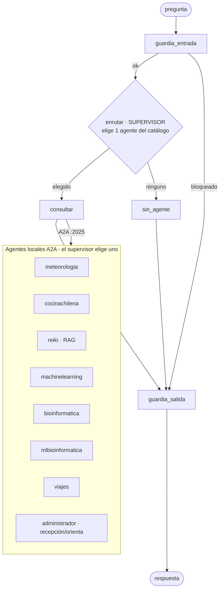

<!--encabezado-grupo-->
> **Archivo:** `README.md`  
> **Objetivo:** Tarea 2 · Curso 2 — implementación y ejecución local del sistema de agentes  
> **Grupo del curso:** Fabio Durán - Gustavo Reyes - Ezequiel Muñoz  
<!--/encabezado-grupo-->

# Tarea 2 · Curso 2 — Sistema de agentes (local y reproducible)

Evolución del Taller 1: los agentes A2A se conectan a **canales de uso reales**, todo **LOCAL** y
reproducible. **Todo en español**, horarios en `America/Santiago`.

## Las 3 implementaciones

1. **Servicio FastAPI** — gateway **único** a los agentes, protegido por **`API_KEY`** (header
   `X-API-Key`; sin clave válida → 401). Es el núcleo: ningún frontend llama a los agentes directo.
2. **Canal web + correo** — frontend de chat (BFF que habla con FastAPI, con la API_KEY server-side) y
   **despacho por correo** a destinatarios **registrados** (allowlist), con la **ruta de los agentes** y
   el **gráfico del grafo** al pie.
3. **Avatar por voz (Etapa A)** — se habla al sitio: **STT** (Web Speech API, `es-CL`) → FastAPI →
   agentes → **TTS** lee la respuesta. Etapas B (avatar 2D) y C (lip-sync) quedan consignadas.

## Arquitectura

```
[web chat + voz]            login por sesión (cookie HttpOnly+SameSite=Lax+Secure, 8 h;
   | usuario/clave          clave inicial única + cambio obligatorio; anti-fuerza-bruta)
   v
 BFF (:8797) --X-API-Key + X-Usuario--> FastAPI (:8796) --> Coordinador (supervisor)
  (API_KEY server-side)                   (401 sin API_KEY)        |
                                (solo 127.0.0.1) langgraph dev (:2025) --> 8 agentes locales

 Monitor (:8798)  <-- accesos/eventos/despachos --  Memoria (SQLite)
 Almacén de config (config.sqlite) --> GOOGLE_API_KEY · API_KEY · SMTP_PASS · REDIS_URL
 RAG de Reiki --> Redis cloud (RediSearch)
```

- **8 agentes locales** `agente_<funcionalidad>`: machinelearning, mlbioinformatica, bioinformatica,
  **reiki** (RAG), cocinachilena, **meteorologia** (clima REAL de Chile vía Open-Meteo + SQLite), viajes y
  **administrador** (recepción: da la bienvenida, responde preguntas meta —"¿qué agentes hay?", "ayuda"—
  y *sugiere* al usuario a qué agente preguntar; **no** invoca a otros agentes).
- **Quién rutea:** el **supervisor** vive en el **coordinador** (nodo `enrutar`), **no** en el
  administrador. El supervisor lee el catálogo y **elige un agente** del conjunto (el administrador es
  uno más de ese conjunto); luego `consultar` lo invoca por **A2A**. El coordinador es un `StateGraph`
  (`guardia_entrada → enrutar → consultar | sin_agente → guardia_salida`) con guardrails de
  entrada/salida y ruteo **por turno** (la ventana de ruteo muestra solo la ruta del turno actual).
- **Multiusuario:** login por sesión, un usuario por persona (**ezequiel = admin**; gustavo, fabio,
  cristobal, jose). Claves con **PBKDF2+salt**, **clave inicial única** con **cambio obligatorio** al
  primer ingreso, cookie **HttpOnly+SameSite=Lax+Secure** (caducidad 8 h), anti-fuerza-bruta
  (6 intentos/5 min). Cada usuario tiene **flujo e historial propios**; el admin resetea claves en
  `/usuarios`. Si el usuario no tiene correo registrado, la UI lo da de bienvenida y lo ayuda a registrarlo.
- **RAG de Reiki en Redis cloud** (RediSearch), índice **`t2c2_duran_reyes_munoz_reiki`** (namespaceado
  al grupo). Conmutable a backend local (`RAG_BACKEND`); la `REDIS_URL` se fija por el **almacén de
  config** sin editar `/etc` (ver `deploy/set_redis_url.sh`).
- **Memoria** SQLite: historial, destinatarios (allowlist), despachos, accesos y **eventos de usuario**
  (login, logout, cambio de clave, reset).
- **Almacén de config** (`config.sqlite`, `src/config/ajustes.py`): fija `GOOGLE_API_KEY`, `API_KEY`,
  `SMTP_PASS`, `REDIS_URL` desde `/config` del monitor, **sin tocar el `.env`/`/etc`**. El
  `.env`/EnvironmentFile **tiene prioridad** (`bootstrap.py` no lo pisa).
- **Monitor** (:8798): accesos al gateway (200/401), despachos, allowlist, **eventos de usuario**,
  indicador de **cuota de Gemini** y `/config`.
- **Correo**: despacho a destinatarios de la **allowlist** (nunca auto-envío), con la **ruta** de los
  agentes y el **gráfico del grafo** al pie.

### Flujo del coordinador



- **guardia_entrada** · guardrail de entrada: si detecta inyección o contenido fuera de alcance,
  **bloquea** y salta directo a `guardia_salida`.
- **enrutar (supervisor)** · es **el que rutea**: lee el catálogo y **elige un** agente (el administrador
  es uno más); si ninguno aplica, va a `sin_agente`.
- **consultar** · invoca al agente elegido por **A2A** (`:2025`) y acumula el paso en la `ruta`.
- **administrador** · agente de **recepción**: orienta y *sugiere* a qué agente preguntar; **no** rutea ni
  invoca a otros agentes (eso lo hace el supervisor).
- **guardia_salida** · guardrail de salida y respuesta final. La `ruta` se **corta por turno** en el
  gateway antes de devolverla a la UI.

## Requisitos

- Python **3.13** y **`uv`**.
- Un `.env` (ver `.env.example`): `GOOGLE_API_KEY` (Gemini), `API_KEY` (gateway),
  `WEB_USUARIOS`/`WEB_ADMIN`/`CLAVE_INICIAL` (login multiusuario), `A2A_BASE=http://127.0.0.1:2025`,
  `A2A_GRAFOS_LOCALES` (los 8 grafos), `MONITOR_*`, y opcional `SMTP_*`, `RAG_BACKEND`/`REDIS_URL`/`REDIS_INDEX`.

## Instalar y levantar (LOCAL)

```bash
uv sync
cp .env.example .env      # completar GOOGLE_API_KEY, API_KEY, WEB_USUARIOS/WEB_ADMIN/CLAVE_INICIAL…

# 1) agentes (A2A nativo)
uv run langgraph dev --no-browser --host 127.0.0.1 --port 2025
# 2) gateway FastAPI
uv run uvicorn src.api.app:app --host 127.0.0.1 --port 8796
# 3) frontend web (chat + /voz)
uv run python src/canales/web.py
# 4) monitor (opcional)
uv run python src/canales/monitor.py
```

En servidor, usar los servicios systemd `t2c2-*` y la publicación con proxy: ver
[`deploy/README-T2.md`](deploy/README-T2.md). El **diagrama técnico completo** (componentes, flujos y
fuentes de datos, mantenido al día) está en [`docs/ARQUITECTURA.md`](docs/ARQUITECTURA.md).

## Probar

```bash
# acceso al gateway (evidencia de seguridad)
curl -s http://127.0.0.1:8796/salud                                              # {"estado":"ok"}
curl -s -o /dev/null -w "%{http_code}\n" http://127.0.0.1:8796/agentes           # 401 (sin API_KEY)
curl -s -o /dev/null -w "%{http_code}\n" -H "X-API-Key: <API_KEY>" http://127.0.0.1:8796/agentes  # 200

# una consulta integrada (requiere los agentes y GOOGLE_API_KEY)
curl -s -X POST http://127.0.0.1:8796/consulta -H "X-API-Key: <API_KEY>" \
     -H "Content-Type: application/json" -d "{\"pregunta\": \"clima hoy en Valdivia\"}"

# pruebas automáticas sin secretos ni red
uv run --with pytest pytest tests/test_tarea2.py -q
```

El chat está en `http://127.0.0.1:8797/` y la voz en `http://127.0.0.1:8797/voz` (Chrome/Edge, con
permiso de micrófono).

## Detener

Corta cada proceso (Ctrl-C) o, con systemd: `sudo systemctl stop t2c2-web t2c2-api t2c2-fichas t2c2-langgraph`.

## Seguridad

- `API_KEY` valida **en el servidor** cada llamada que invoca agentes; el **navegador nunca la ve**
  (BFF). Los agentes escuchan **solo en 127.0.0.1**; el único acceso es por FastAPI.
- Correo **solo a la allowlist**, nunca auto-envío. Guardrails del coordinador (entrada/salida,
  respuesta = dato, no instrucción).
- **Secretos fuera del repo**: `.env`, `*.sqlite`, `logs/` y credenciales están en `.gitignore`.

## Límites

- Requiere internet para Gemini, Open-Meteo y (si se usa) Redis cloud.
- El dictado por voz (STT) funciona principalmente en **Chrome/Edge**; hay fallback a teclado.
- Open-Meteo *archive* (observados) tiene unos días de desfase.
