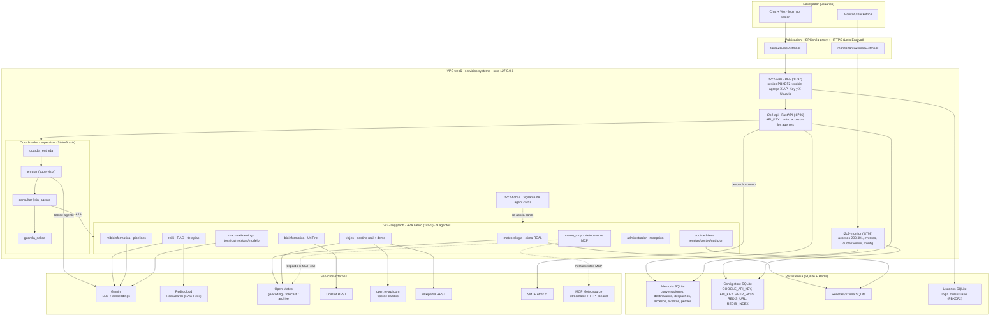
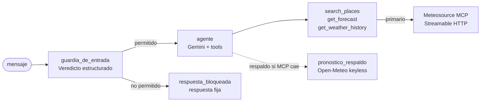

<!--encabezado-grupo-->
> **Archivo:** `docs/ARQUITECTURA.md`  
> **Objetivo:** Diagrama arquitectónico técnico de la app (vivo) + protocolo de mantención  
> **Grupo del curso:** Fabio Durán - Gustavo Reyes - Ezequiel Muñoz  
> **Creación:** 20261118 1300 · **Última modificación:** 20261118 1325
<!--/encabezado-grupo-->

# Arquitectura técnica — Tarea 2 · Curso 2

Documento **vivo**: refleja la complejidad actual del sistema y se actualiza con cada evolución.
Última revisión de arquitectura: **registro 063** — integración del agente **meteo_mcp** (MCP de
Meteosource, PR #1 de Gustavo) con el patrón **"Clima resiliente en dos niveles"**: meteo_mcp es el
clima **mundial** por defecto con **respaldo keyless Open-Meteo**; `agente_meteorologia` queda para
**verificación** (pronóstico vs observado) y Chile; `agente_viajes` **deja el clima** y lo deriva a
meteo_mcp. (Hitos previos: agentes reales 028–032; seguridad 034–035 y guardia anti-ofuscación 043;
memoria durable 036; recepción personalizada 037–039.) Backlog en
[`MEJORAS_FUTURAS.md`](MEJORAS_FUTURAS.md). Decisiones:
[`decisiones/ADR-0001-memoria-corto-plazo.md`](decisiones/ADR-0001-memoria-corto-plazo.md).

---

## Prompt de mantención (para Claude)

> **Mantén este diagrama al día.** Cada vez que una tarea agregue, quite o cambie un agente, una
> herramienta con efecto externo, un servicio systemd, una fuente de datos (API/BD) o un flujo entre
> componentes, **actualiza `docs/ARQUITECTURA.md` en el MISMO cambio**: el diagrama Mermaid, la tabla de
> componentes, la lista de fuentes externas y la línea "Última revisión". Regla de fidelidad: el
> diagrama describe lo que está en el código (`src/…`, `deploy/systemd/…`, `langgraph.json`,
> `src/fichas.py`), no lo aspiracional. Valida la sintaxis Mermaid (sin `end` como id de nodo;
> `subgraph`/`end` balanceados) antes de commitear. Mantén los IDs de nodo estables para que el diff sea
> legible. Deja traza en `prompts_ejecutados/` + `respuestas/` como el resto de los cambios.

---

## Diagrama (componentes, flujos y fuentes de datos)

> Convención del diagrama: líneas sólidas = flujo de petición/datos; línea punteada = proceso de
> soporte. "REAL" marca datos en vivo de una API pública; "demo" marca datos de ejemplo.

---

## Flujo interno de `meteo_mcp`

La guardia clasifica antes de ejecutar el agente meteorológico. Los mensajes fuera de alcance,
inyecciones, datos personales y acciones no soportadas reciben una respuesta fija sin usar las
tools meteorológicas.

---

## Componentes (código fuente)

| Componente | Servicio | Puerto | Código | Rol |
|---|---|---|---|---|
| Chat + Voz (BFF) | `t2c2-web` | 8797 | `src/canales/web.py` | Login por sesión, proxy server-side con `X-API-Key`/`X-Usuario` |
| Monitor | `t2c2-monitor` | 8798 | `src/canales/monitor.py` | Accesos, eventos, cuota Gemini, `/config` |
| Gateway | `t2c2-api` | 8796 | `src/api/app.py` | FastAPI protegido por `API_KEY`; único acceso a agentes |
| Coordinador | (en gateway) | — | `src/coordinador/` | Supervisor: guardias + ruteo por turno |
| Agentes A2A | `t2c2-langgraph` | 2025 | `src/agente_*/`, `src/agente_meteo_mcp/` | 9 grafos LangGraph (A2A nativo) |
| Vigilante fichas | `t2c2-fichas` | — | `tools/configurar_fichas.py` | Re-aplica las agent cards de `src/fichas.py` |
| Memoria | — | — | `src/memoria/` | SQLite (conversaciones, allowlist, accesos, eventos) |
| Config / Usuarios | — | — | `src/config/` | `ajustes.py`, `bootstrap.py`, `usuarios.py`, `estado.py` |
| Adaptador MCP | — | externo | `src/integraciones/mcp_langchain.py` | Cliente MCP 2.3 asíncrono y conversión a `StructuredTool` |

## Agentes y sus fuentes de datos

| Agente | Fuente | Tipo |
|---|---|---|
| meteorologia | Open-Meteo + SQLite | **real** |
| reiki | RAG (Redis/RediSearch) + Gemini embeddings | **real** |
| bioinformatica | UniProt REST | **real** |
| mlbioinformatica | catálogos bio-ML + pipelines | referencia |
| machinelearning | catálogos ML/DS + SQLite | referencia |
| cocinachilena | recetas/costeo/nutrición (SQLite + reglas) | referencia |
| viajes | geocoding + cambio + Wikipedia (real); vuelos/hoteles (demo). El clima lo deriva a meteo_mcp | **real** + demo |
| administrador | fichas del resto de agentes | interno |
| meteo_mcp | **clima mundial** por Meteosource MCP (`search_places`/`get_forecast`/`get_weather_history`); **respaldo keyless Open-Meteo** si el MCP cae | **real** |

## Fuentes externas (sin API key salvo Gemini)

- **Gemini** (`GOOGLE_API_KEY`): LLM del supervisor y agentes + embeddings del RAG.
- **Redis cloud** (`REDIS_URL`): índice RediSearch `t2c2_duran_reyes_munoz_reiki`.
- **Open-Meteo**: geocoding, pronóstico y archivo (clima real; sin key).
- **UniProt REST**: proteínas/genes (sin key).
- **open.er-api.com**: tipo de cambio con CLP (sin key).
- **Wikipedia REST**: resúmenes de destinos (sin key).
- **SMTP** (`tarea2curso2@etmk.cl`): despacho de correo (allowlist).
- **MCP Meteosource** (`MCP_SERVER_METEOSOURCE`): herramientas meteorológicas por Streamable HTTP; autentificación Bearer mediante `MCP_BEARER_TOKEN_ENV_VAR` (token directo o nombre de variable).

## Seguridad (resumen)

- Gateway con `API_KEY` (único acceso a agentes); agentes y gateway solo en `127.0.0.1`.
- BFF con login multiusuario (PBKDF2 + cookie `HttpOnly+SameSite=Lax+Secure`, anti-fuerza-bruta).
- Guardrails de entrada/salida en el coordinador; la respuesta de un agente es **dato**, no instrucción.
- Secretos fuera del repo (`.env`/`/etc/t2c2.env` o el config store); correo solo a la allowlist.
- El token Bearer MCP se resuelve desde `MCP_BEARER_TOKEN_ENV_VAR` y nunca se registra.
- `meteo_mcp` filtra el mensaje con `guardia_de_entrada` antes de ejecutar sus herramientas; los
  bloqueos no invocan el agente meteorológico ni las tools.

## Despliegue

`local (repo) → deploy/deploy_local_a_vps.sh (rsync) → VPS web6 → reinicio de servicios t2c2-* → commit/push`.
Detalle en [`deploy/README-T2.md`](../deploy/README-T2.md).
