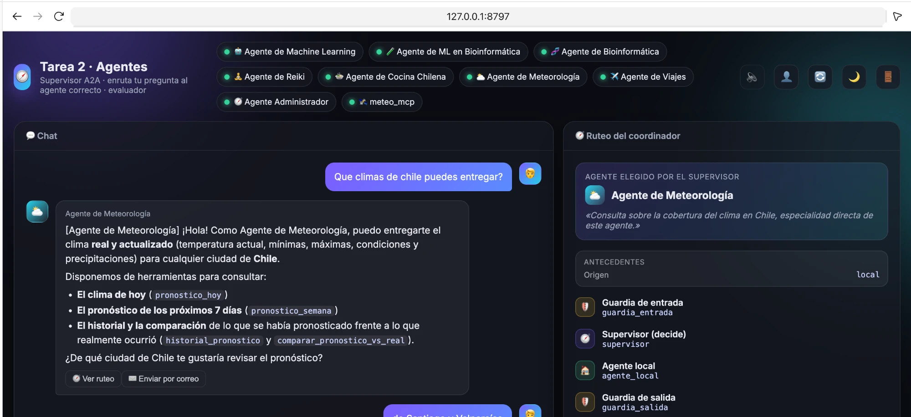
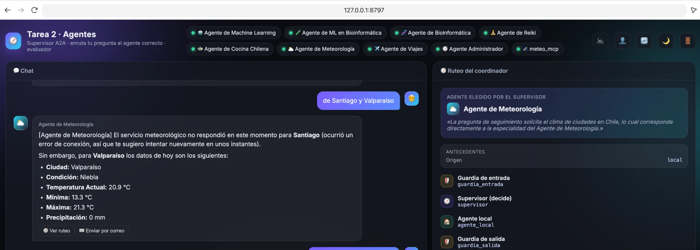
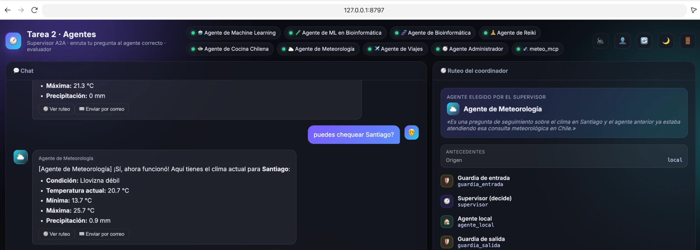
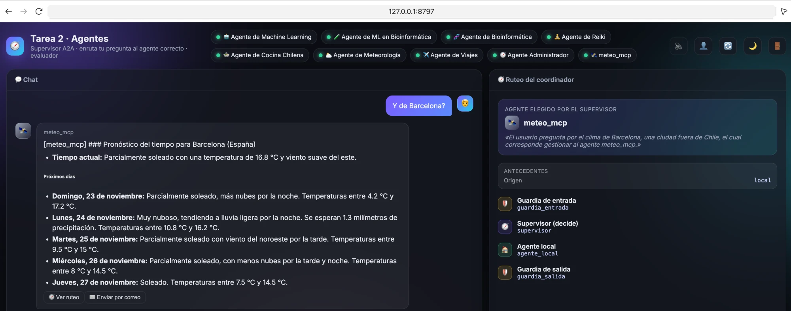
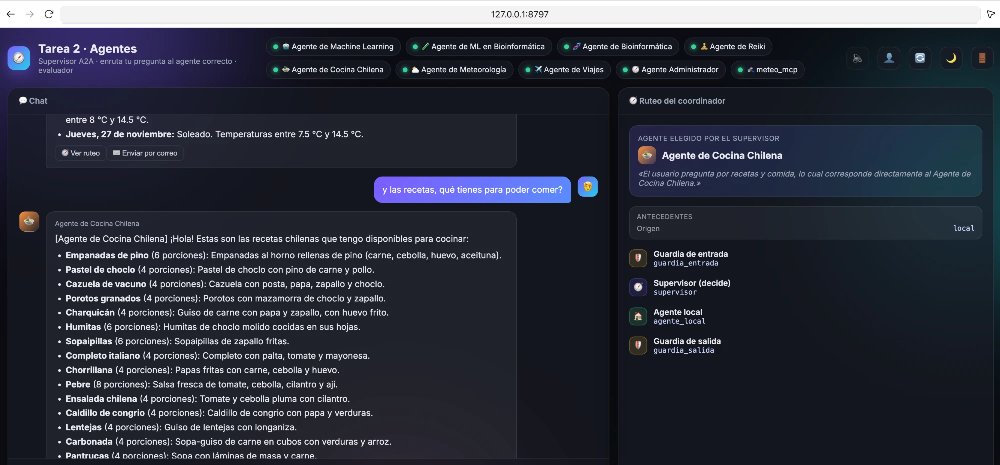
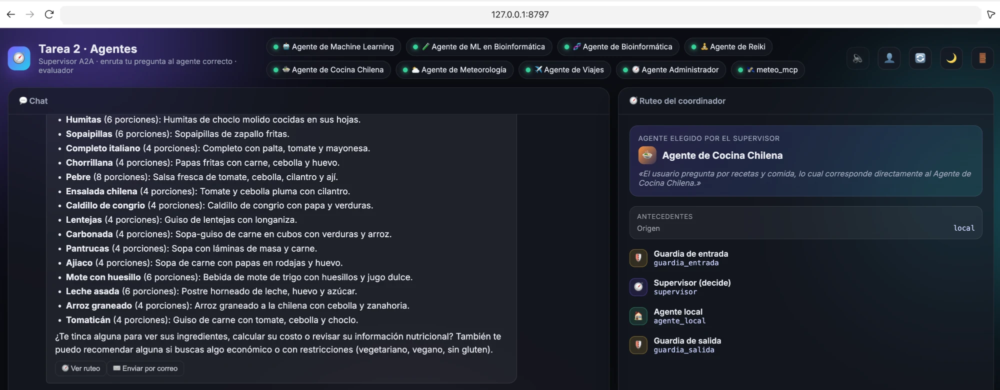
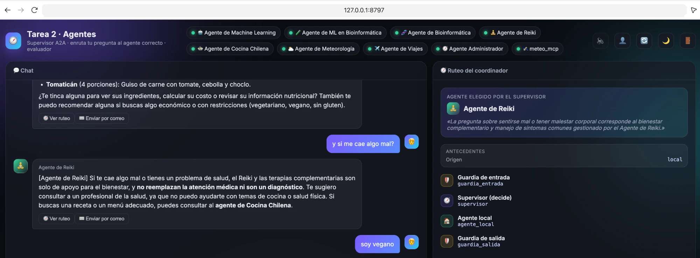
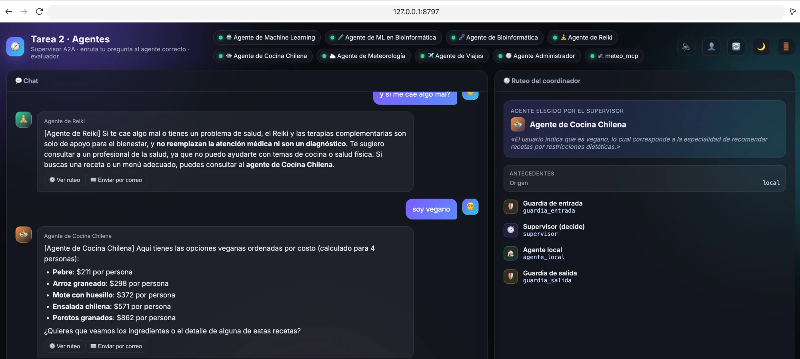

<!--encabezado-grupo-->
> **Archivo:** `evidencias/ui/README.md`
> **Objetivo:** Capturas de la UI del chat (canal web) — evidencia LOCAL con pies de foto (5 campos)
> **Grupo del curso:** Fabio Durán - Gustavo Reyes - Ezequiel Muñoz
<!--/encabezado-grupo-->

# Capturas del canal web (chat) — **LOCAL**, 2026-11-23

Capturas de ejecución real en `http://127.0.0.1:8797/` (usuario de prueba `evaluador`). Cada una
muestra **pedido → ruteo del coordinador → respuesta del agente** en el canal, con el panel "Ruteo del
coordinador" (agente elegido + ruta A2A `guardia_entrada → supervisor → agente_local → guardia_salida`).
Entorno **LOCAL** (no producción). La API_KEY no aparece (el BFF la agrega server-side).

> Las **8 capturas PNG** están en esta carpeta (convertidas de los originales del equipo). Se tomaron
> en una **misma conversación** en el chat local, con el panel "Ruteo del coordinador" visible.

## 1. Cobertura de meteorología (Chile)

- **Entorno y fecha:** LOCAL, 2026-11-23
- **Solicitud:** «Que climas de chile puedes entregar?»
- **Resultado esperado:** ruteo a Meteorología, que describe su cobertura (Chile) y herramientas.
- **Resultado obtenido:** **Agente de Meteorología** lista `pronostico_hoy`, `pronostico_semana`,
  `historial_pronostico`, `comparar_pronostico_vs_real`. Panel de ruteo con origen `local`.
- **Observaciones:** —

## 2. Seguimiento multi-ciudad + resiliencia del proveedor

- **Entorno y fecha:** LOCAL, 2026-11-23
- **Solicitud (seguimiento):** «de Santiago y Valparaíso»
- **Resultado esperado:** datos de clima de ambas; si una fuente falla, un mensaje claro (no éxito falso).
- **Resultado obtenido:** **Agente de Meteorología** entrega Valparaíso (Niebla, 20.9 °C) y para Santiago
  avisa *"el servicio no respondió… ocurrió un error de conexión, intenta nuevamente"* — **sin fingir éxito**.
- **Observaciones:** cumple la rúbrica: *"las fallas del proveedor producen mensajes claros; no deben
  presentarse como operaciones exitosas"*. Fallo transitorio de Open-Meteo.

## 3. Reintento exitoso (recuperación)

- **Entorno y fecha:** LOCAL, 2026-11-23
- **Solicitud (seguimiento):** «puedes chequear Santiago?»
- **Resultado esperado:** al reintentar, entrega el clima de Santiago.
- **Resultado obtenido:** **Agente de Meteorología** *"¡Sí, ahora funcionó!"* — Santiago: Llovizna débil,
  20.7 °C, mín 13.7 / máx 25.7, 0.9 mm.
- **Observaciones:** continuidad del seguimiento (se mantiene Meteorología para una ciudad de Chile).

## 4. ⭐ Seguimiento que RE-RUTEA al cambiar de dominio (registro 068)

- **Entorno y fecha:** LOCAL, 2026-11-23
- **Solicitud (seguimiento):** «Y de Barcelona?»
- **Resultado esperado:** al ser una ciudad fuera de Chile, debe cambiar a `meteo_mcp` (no quedarse en
  Meteorología de Chile).
- **Resultado obtenido:** **meteo_mcp** — Barcelona (España): 16.8 °C + pronóstico a 7 días. Motivo del
  supervisor: *"una ciudad fuera de Chile, el cual corresponde gestionar al agente meteo_mcp"*.
- **Observaciones:** evidencia del arreglo del registro 068 (el seguimiento ya no se queda en un agente
  que no puede responder).

## 5. Cambio de tema → Cocina Chilena

- **Entorno y fecha:** LOCAL, 2026-11-23
- **Solicitud (seguimiento):** «y las recetas, qué tienes para poder comer?»
- **Resultado esperado:** ruteo a Cocina Chilena con el catálogo de recetas.
- **Resultado obtenido:** **Agente de Cocina Chilena** lista recetas (empanadas, pastel de choclo,
  cazuela, …) y ofrece costo/nutrición/restricciones.
- **Observaciones:** el seguimiento cambió de dominio (clima → cocina) correctamente.

## 5b. Catálogo de recetas (continuación) + oferta de costeo/nutrición/restricciones

- **Entorno y fecha:** LOCAL, 2026-11-23
- **Solicitud:** (misma respuesta de Cocina, desplazada) — continuación del listado.
- **Resultado obtenido:** lista completa (humitas, sopaipillas, pantrucas, mote con huesillo, …) y la
  invitación a ver ingredientes, **calcular costo**, revisar **nutrición** o filtrar por **restricción**
  (vegetariano, vegano, sin gluten).
- **Observaciones:** muestra la amplitud del agente de Cocina (catálogo + costeo + restricciones).

## 6. Guardrail de dominio: Reiki no hace de médico

- **Entorno y fecha:** LOCAL, 2026-11-23
- **Solicitud (seguimiento):** «y si me cae algo mal?»
- **Resultado esperado:** bienestar complementario, sin diagnóstico médico.
- **Resultado obtenido:** **Agente de Reiki** aclara que *"no reemplazan la atención médica ni son un
  diagnóstico"* y sugiere un profesional; deriva lo culinario a Cocina.
- **Observaciones:** buen límite de alcance (no se excede de su especialidad).

## 7. Restricción dietética aplicada (vegano + costo)

- **Entorno y fecha:** LOCAL, 2026-11-23
- **Solicitud (seguimiento):** «soy vegano»
- **Resultado esperado:** Cocina Chilena filtra recetas veganas.
- **Resultado obtenido:** **Agente de Cocina Chilena** entrega opciones veganas ordenadas por costo
  (Pebre $211/persona, Arroz graneado $298, …).
- **Observaciones:** combina restricción dietética + costeo real.
